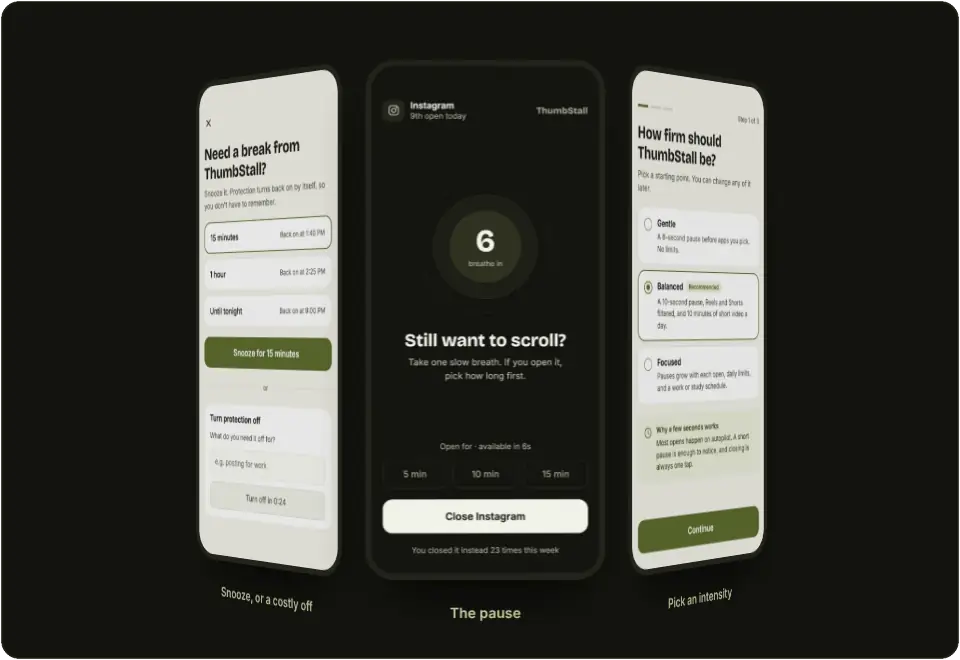

<div align="center">

<a href="https://suriya4code.github.io/ThumbStall/"></a>

# ThumbStall

**Free, open-source anti-doomscrolling app for Android.**
<br />
*Pause the reel. Play your life!*

[](https://suriya4code.github.io/ThumbStall/)

[](https://github.com/suriya4code/ThumbStall/actions/workflows/ci.yml)
[](https://github.com/suriya4code/ThumbStall/releases/latest)
[](LICENSE)
[](#install)
[](#build-from-source)
[](#privacy)

[**Website**](https://suriya4code.github.io/ThumbStall/) · [**Download APK**](https://github.com/suriya4code/ThumbStall/releases/latest) · [**Build from source**](#build-from-source) · [**How it works**](#how-it-works) · [**Contribute**](CONTRIBUTING.md)

</div>


ThumbStall adds a brief pause before opening distracting apps, giving you a moment to reconsider. No accounts, no internet, no tracking — everything stays on your device.

<a name="try"></a>
<a href="https://suriya4code.github.io/ThumbStall/#try"></a>

<a href="https://suriya4code.github.io/ThumbStall/#try"></a>

Most opens happen on autopilot. A short pause is enough to notice, and closing is always one tap. Open the same app again within the hour and the wait grows by 5 seconds, up to 30. **[Try the live version on the website →](https://suriya4code.github.io/ThumbStall/#try)**

<a name="features"></a>


<details>
<summary><b>Feature list as text</b></summary>

- **Pause screen** — A breathing countdown before any app you choose
- **Escalating delays** — Repeat opens get longer pauses
- **Session budget** — Grant yourself 5/10/15 minutes when you really need it
- **Snooze** — Temporarily disable protection (15 min / 1 hour / until tonight)
- **Costly override** — Turning protection off takes a reason and a 24-second wait
- **Essentials allowlist** — Dialer, SMS, and maps are never blocked
- **Positive stats** — See time reclaimed, not shame metrics
- **OEM battery guide** — Manufacturer-specific instructions to keep protection running
- **Dark mode** — Follows system theme
- **Fully offline** — No internet permission, no analytics, no cloud

</details>

<a name="how-it-works"></a>




A foreground service polls `UsageStatsManager` for the app in front. Every decision after that is made by the pure Kotlin rules engine in `core/` (`PauseRules`, `OverlayGate`, `OpenTracker`, `BudgetTracker`, `SnoozeState`, `StatsWindows`), which has no Android dependencies and is tested on the JVM.

```
app/         # Android app (Compose UI, services, Room database)
core/        # Pure Kotlin rules engine (JVM-tested, no Android deps)
docs/        # Design specs, plans, signing guide
```

<a name="privacy"></a>




- **No internet access** — The app has no INTERNET permission
- **No accounts** — No sign-up, no login, no cloud sync
- **No tracking** — No analytics, no crash reporting, no telemetry
- **Local only** — All data stays on your device

<a name="screenshots"></a>




<sub>From the design set. Some screens preview roadmap features such as feed filtering.</sub>

<a name="install"></a>


### From GitHub Releases

1. Download the latest `app-foss-release.apk` from [Releases](https://github.com/suriya4code/ThumbStall/releases)
2. Enable "Install from unknown sources" for your browser/file manager
3. Install the APK

> [!NOTE]
> On **Android 13 and newer**, grant "Allow restricted settings" before Usage Access will work:
> **Settings → Apps → ThumbStall → ⋮ → Allow restricted settings**, then grant Usage Access from the app.

### Build from Source



Requirements: Android Studio or JDK 17+, and the Android SDK with platform 36.

```bash
git clone https://github.com/suriya4code/ThumbStall.git
cd ThumbStall
./gradlew assembleFossDebug   # → app/build/outputs/apk/foss/debug/app-foss-debug.apk
./gradlew :core:test          # rules engine tests
```

For release builds, see [docs/signing.md](docs/signing.md).

<a name="roadmap"></a>




## Contributing

See [CONTRIBUTING.md](CONTRIBUTING.md).

## License

GPL-3.0 — see [LICENSE](LICENSE).

<br />

<a href="https://suriya4code.github.io/ThumbStall/"></a>
