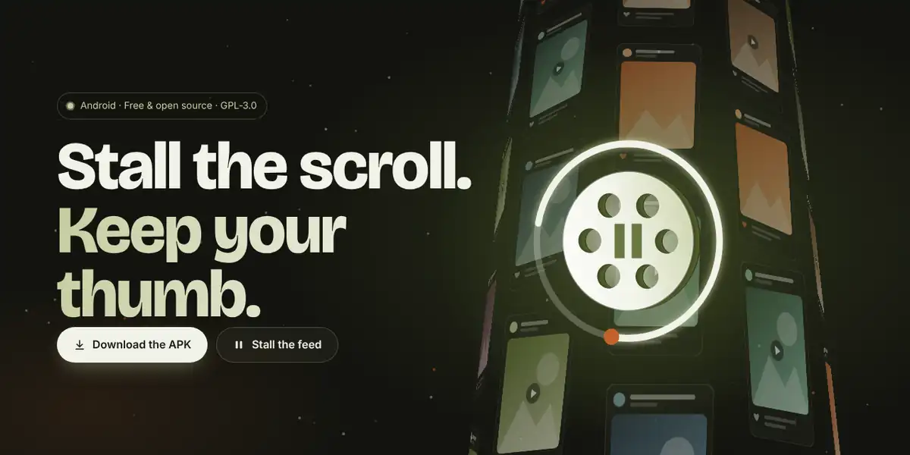
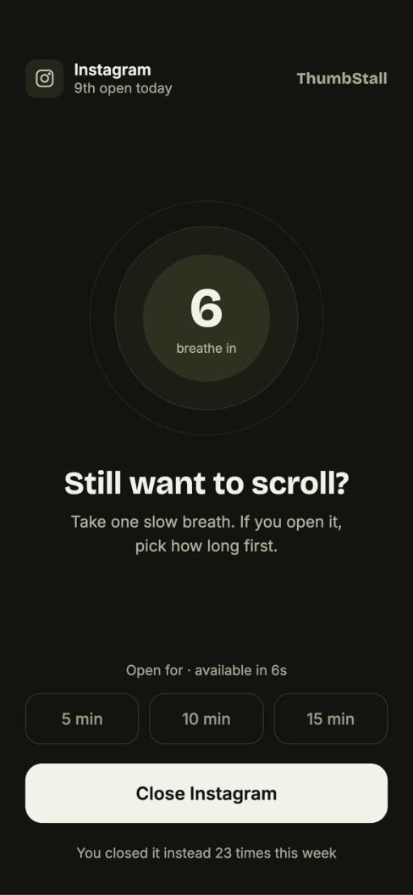
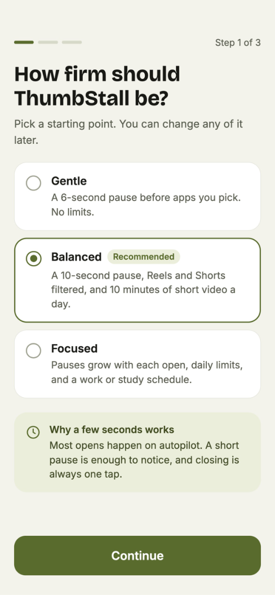
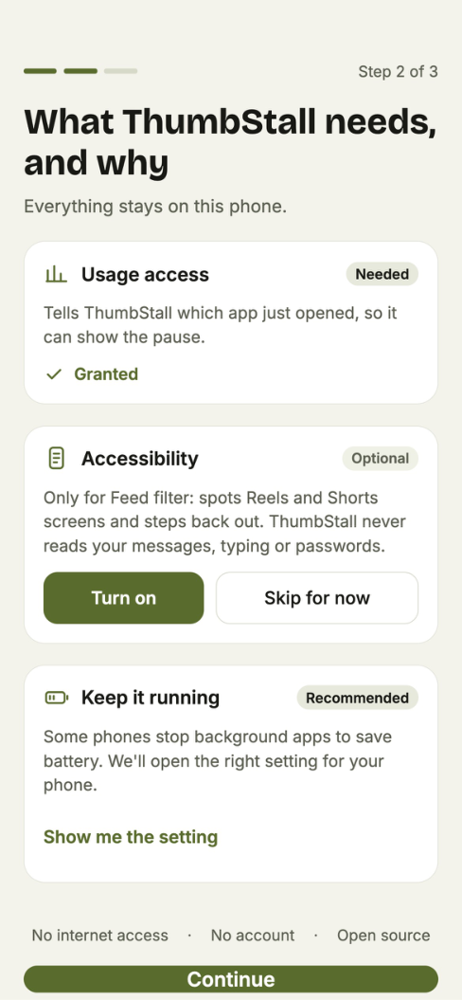
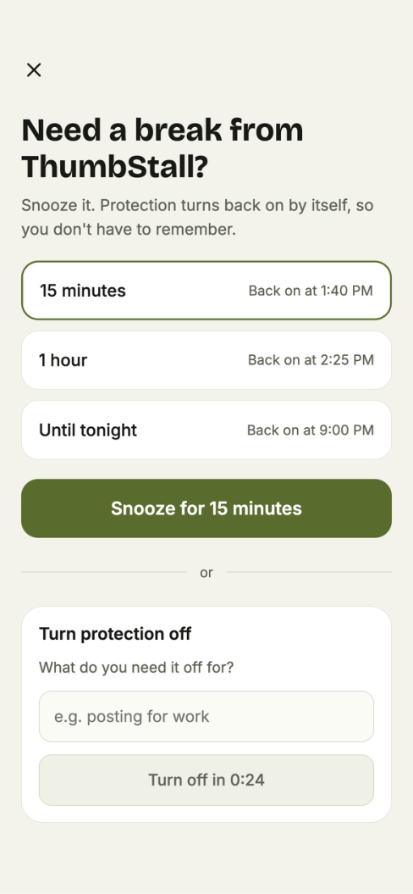

<div align="center">

<a href="https://suriya4code.github.io/ThumbStall/"></a>

# ThumbStall

**Free, open-source anti-doomscrolling app for Android.**
<br />
*Pause the reel. Play your life!*

[](https://suriya4code.github.io/ThumbStall/)

[](https://github.com/suriya4code/ThumbStall/actions/workflows/ci.yml)
[](https://github.com/suriya4code/ThumbStall/releases/latest)
[](LICENSE)
[](#install)
[](#build-from-source)
[](#privacy)

[**Website**](https://suriya4code.github.io/ThumbStall/) · [**Download APK**](https://github.com/suriya4code/ThumbStall/releases/latest) · [**Build from source**](#build-from-source) · [**How it works**](#how-it-works) · [**Contribute**](CONTRIBUTING.md)

</div>

---

ThumbStall adds a brief pause before opening distracting apps, giving you a moment to reconsider. No accounts, no internet, no tracking — everything stays on your device.

> **Try it in your browser:** the [website](https://suriya4code.github.io/ThumbStall/#try) has a working pause screen that runs the same escalation rule as the app.

## Features

- **Pause screen** — A breathing countdown before any app you choose
- **Escalating delays** — Repeat opens get longer pauses
- **Session budget** — Grant yourself 5/10/15 minutes when you really need it
- **Snooze** — Temporarily disable protection (15 min / 1 hour / until tonight)
- **Essentials allowlist** — Dialer, SMS, and maps are never blocked
- **Positive stats** — See time reclaimed, not shame metrics
- **OEM battery guide** — Manufacturer-specific instructions to keep protection running
- **Dark mode** — Follows system theme
- **Fully offline** — No internet permission, no analytics, no cloud

## How it works



A foreground service polls `UsageStatsManager` for the app in front. Every decision after that is made by the pure Kotlin rules engine in `core/`, which has no Android dependencies and is tested on the JVM: escalation is `min(base + 5 s × repeats in the last hour, 30 s)`.

## Screenshots

<p align="center">
  
  
  
  
</p>

<sub>From the design set. Some screens preview roadmap features such as feed filtering.</sub>

## Install

### From GitHub Releases

1. Download the latest `app-foss-release.apk` from [Releases](https://github.com/suriya4code/ThumbStall/releases)
2. Enable "Install from unknown sources" for your browser/file manager
3. Install the APK

### Android 13+ Note

On Android 13 and newer, you may need to grant "Allow restricted settings" before Usage Access will work:
1. After installing, go to **Settings → Apps → ThumbStall**
2. Tap the ⋮ menu → **Allow restricted settings**
3. Then grant Usage Access from the app

## Build from Source

Requirements:
- Android Studio or JDK 17+
- Android SDK with platform 36

```bash
# Clone
git clone https://github.com/suriya4code/ThumbStall.git
cd ThumbStall

# Build debug APK
./gradlew assembleFossDebug

# Output: app/build/outputs/apk/foss/debug/app-foss-debug.apk
```

For release builds, see [docs/signing.md](docs/signing.md).

## Project Structure

```
app/         # Android app (Compose UI, services, Room database)
core/        # Pure Kotlin rules engine (JVM-tested, no Android deps)
docs/        # Design specs, plans, signing guide
```

## Contributing

See [CONTRIBUTING.md](CONTRIBUTING.md).

## License

GPL-3.0 — see [LICENSE](LICENSE).

## Privacy

- **No internet access** — The app has no INTERNET permission
- **No accounts** — No sign-up, no login, no cloud sync
- **No tracking** — No analytics, no crash reporting, no telemetry
- **Local only** — All data stays on your device

## Roadmap

v0.1 (current):
- [x] Pause screen with breathing countdown
- [x] App picker, escalation, session budget
- [x] Snooze and costly override
- [x] Stats dashboard
- [x] Onboarding flow

Future:
- [ ] Feed blocking (Reels, Shorts) via Accessibility
- [ ] Daily time limits
- [ ] Schedules (work hours, bedtime)
- [ ] F-Droid / IzzyOnDroid distribution
